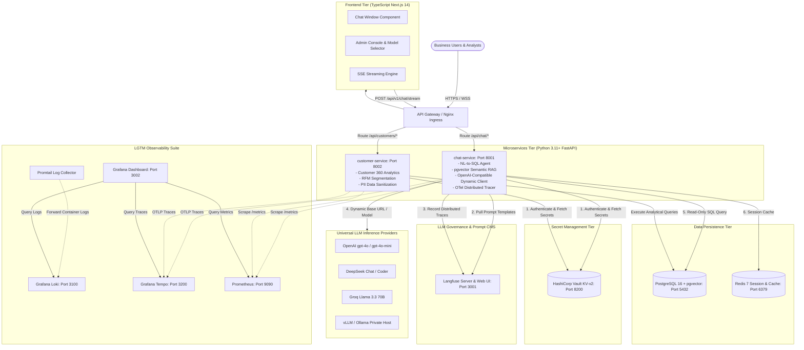
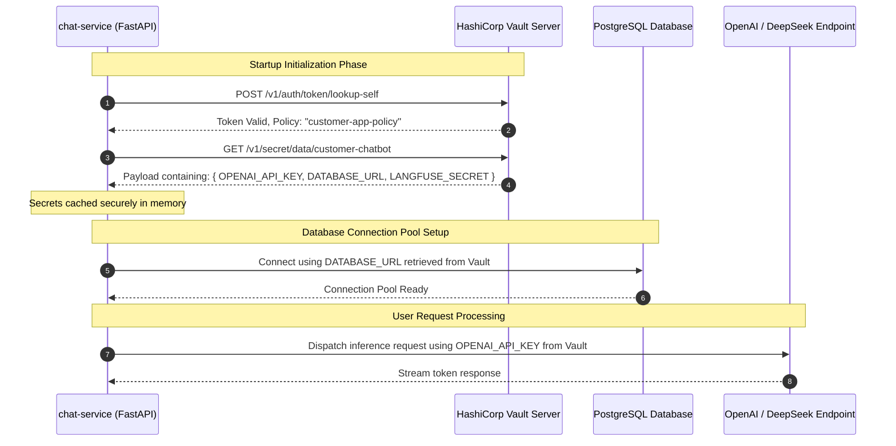
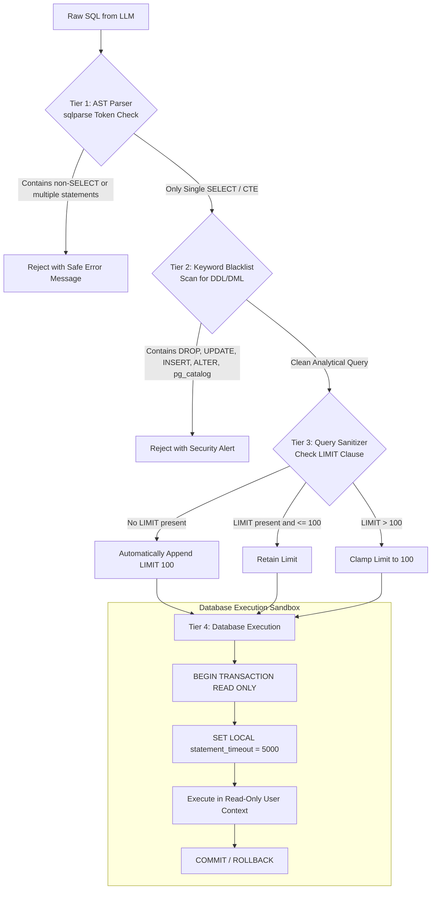
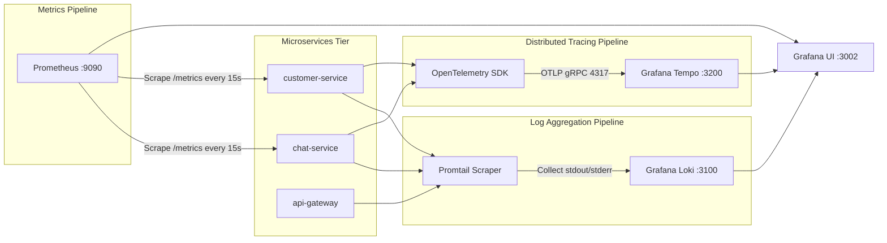

# 🏛️ SYSTEM ARCHITECTURE & ENGINEERING SPECIFICATION

This document provides a comprehensive technical breakdown of the **Enterprise Customer Intelligence Chatbot Platform**, covering microservice boundaries, data flow pipelines, HashiCorp Vault security patterns, Langfuse LLMOps integration, and the LGTM observability telemetry pipeline.

---

## 1. HIGH-LEVEL ARCHITECTURE OVERVIEW

The system follows a cloud-native, stateless microservices architecture designed to decouple user interactions from heavy analytical execution, AI inference, and secret governance.



---

## 2. DETAILED SERVICE RESPONSIBILITIES

### 2.1. `frontend` (TypeScript & Next.js 14)
- **Framework**: Next.js 14 (App Router), React 18, Tailwind CSS, Lucide Icons, Radix UI.
- **Key Capabilities**:
  - **Server-Sent Events (SSE) Streaming**: Consumes chunks incrementally from `chat-service` with low-latency typing effect.
  - **Interactive SQL Inspector**: Collapsible drawer displaying generated SQL query, execution latency (in milliseconds), number of rows returned, and safety verification badge.
  - **Dynamic Admin Console**:
    - Runtime selection of `model_name` (`gpt-4o`, `gpt-4o-mini`, `deepseek-chat`, `llama-3.3-70b-versatile`, `qwen2.5-coder`).
    - Custom `openai_base_url` entry for switching providers (OpenAI, DeepSeek, Groq, local vLLM).
    - Temperature, Top-P, and Max Tokens slider controls.
    - Direct deeplinks to Langfuse Traces for each generated response.

### 2.2. `chat-service` (Python 3.11 & FastAPI)
- **Framework**: FastAPI, Pydantic v2, SQLAlchemy 2.0, Asyncpg, `openai` Python SDK, `hvac` (Vault client), `langfuse` SDK.
- **Core Pipelines**:
  1. **Vault Secret Ingestion**: Authenticates with Vault using token or AppRole at startup to pull credentials (`OPENAI_API_KEY`, `DATABASE_URL`, `LANGFUSE_KEYS`).
  2. **Prompt Management via Langfuse**: Fetches prompt templates dynamically:
     ```python
     prompt = langfuse_client.get_prompt("olist_customer_assistant", version="production")
     ```
  3. **Universal LLM Adapter**: Dispatches requests via `AsyncOpenAI(base_url=config.OPENAI_BASE_URL, api_key=config.OPENAI_API_KEY)` regardless of the underlying backend.
  4. **Intent Classifier & Text-to-SQL Engine**:
     - Evaluates whether the question requires SQL analytics or Vector Search.
     - Generates PostgreSQL-compliant SQL matching Olist's schema.
     - Enforces AST-level query validation and safety limits.
     - Runs the query in a read-only transaction with a 5000ms timeout.
  5. **Semantic Review RAG Engine**:
     - Generates query embedding and calculates cosine distance (`<=>`) against indexed customer reviews in `pgvector`.
  6. **Streaming Synthesizer**: Formats table data and insights into conversational markdown streamed over SSE.

### 2.3. `customer-service` (Python 3.11 & FastAPI)
- **Domain Responsibilities**:
  - Encapsulates direct Customer 360 domain logic:
    - `GET /api/v1/customers/{id}/summary`: Lifetime value, order count, favorite categories, review sentiment.
    - `GET /api/v1/customers/rfm`: Recency, Frequency, Monetary scoring engine.
    - `GET /api/v1/customers/top-spenders`: High-net-worth customer leaderboard by geographic state.
  - Applies PII (Personally Identifiable Information) masking on sensitive customer attributes before exposing them to downstream consumers.

### 2.4. `api-gateway` (Nginx)
- Single entrypoint on port `80`:
  - Routes `/api/v1/chat/*` to `chat-service:8001`
  - Routes `/api/v1/customers/*` to `customer-service:8002`
  - Routes all other traffic to `frontend:3000`
  - Disables proxy buffering (`proxy_buffering off;`) to allow uninterrupted SSE streaming tokens.

---

## 3. HASHICORP VAULT DEEP DIVE (THE VAULT APPLICATION)

### 3.1. Zero-Trust Secrets Lifecycle
To satisfy strict enterprise security requirements, this platform completely removes API keys, database connection strings, and third-party tokens from `.env` files committed to version control.



### 3.2. Vault Configuration & Policy Definition
- **Secret Engine**: KV Version 2 (`kv-v2`) mounted at `secret/`.
- **Secret Path**: `secret/data/customer-chatbot`.
- **ACL Policy (`customer-app-policy.hcl`)**:
  ```hcl
  path "secret/data/customer-chatbot" {
    capabilities = ["read"]
  }
  path "secret/metadata/customer-chatbot" {
    capabilities = ["list", "read"]
  }
  ```

### 3.3. Python Vault Client Implementation Pattern
The microservices utilize an autonomous `VaultClient` that handles token validation, retries with exponential backoff, and graceful fallback to environment variables in offline/local-testing environments:
```python
import hvac
import os

class VaultSecretManager:
    def __init__(self):
        self.vault_url = os.getenv("VAULT_ADDR", "http://vault:8200")
        self.vault_token = os.getenv("VAULT_TOKEN")
        self.client = hvac.Client(url=self.vault_url, token=self.vault_token)

    def get_secrets(self, path="customer-chatbot") -> dict:
        try:
            read_response = self.client.secrets.kv.v2.read_secret_version(
                mount_point="secret", path=path
            )
            return read_response["data"]["data"]
        except Exception as e:
            # Fallback to local environment variables if Vault is unreachable in development
            return os.environ
```

---

## 4. MULTI-LAYER SQL SAFETY & INJECTION MITIGATION

LLM-generated SQL queries represent a severe security risk if executed without validation. This platform implements a **4-Tier Defense-in-Depth SQL Guardrail**:



---

## 5. OBSERVABILITY ARCHITECTURE (LGTM TELEMETRY PIPELINE)



1. **Structured Logging (Loki)**:
   - All Python loggers output JSON with standard keys: `timestamp`, `level`, `service`, `trace_id`, `message`.
   - Promtail maps container labels into indexed Loki streams: `{service="chat-service"}`.
2. **Distributed Tracing (Tempo)**:
   - Python microservices are instrumented with OpenTelemetry (`opentelemetry-instrumentation-fastapi`).
   - W3C `traceparent` headers propagate through Nginx to FastAPI, tracing the full lifecycle:
     - `HTTP POST /api/v1/chat/stream`
     - `Vault.ReadSecret`
     - `Langfuse.GetPrompt`
     - `LLM.GenerateSQL`
     - `Postgres.ExecuteQuery`
     - `LLM.StreamResponse`
3. **Metrics (Prometheus)**:
   - Uses `prometheus-fastapi-instrumentator`.
   - Scrapes metrics: `http_requests_total`, `http_request_duration_seconds`, and custom AI metrics `llm_token_count_total`.
4. **Grafana Dashboard**:
   - Single pre-provisioned dashboard displaying throughput, error rates, p95 latencies, live log explorer, and trace flamegraphs.

---

## 6. PGVECTOR SEMANTIC RETRIEVAL SCHEMA

For searching unstructured customer feedback, customer reviews are embedded and queried via PostgreSQL's `pgvector` extension:

```sql
CREATE EXTENSION IF NOT EXISTS vector;

CREATE TABLE IF NOT EXISTS order_review_embeddings (
    id SERIAL PRIMARY KEY,
    review_id VARCHAR(50) NOT NULL,
    order_id VARCHAR(50) NOT NULL,
    review_score INT,
    review_comment_title TEXT,
    review_comment_message TEXT,
    embedding vector(1536), -- 1536 dimensions for OpenAI text-embedding-3-small, or 768 for open models
    created_at TIMESTAMP DEFAULT CURRENT_TIMESTAMP
);

-- Fast Approximate Nearest Neighbor Index (HNSW with Cosine Similarity)
CREATE INDEX IF NOT EXISTS idx_reviews_hnsw 
ON order_review_embeddings USING hnsw (embedding vector_cosine_ops)
WITH (m = 16, ef_construction = 64);
```
