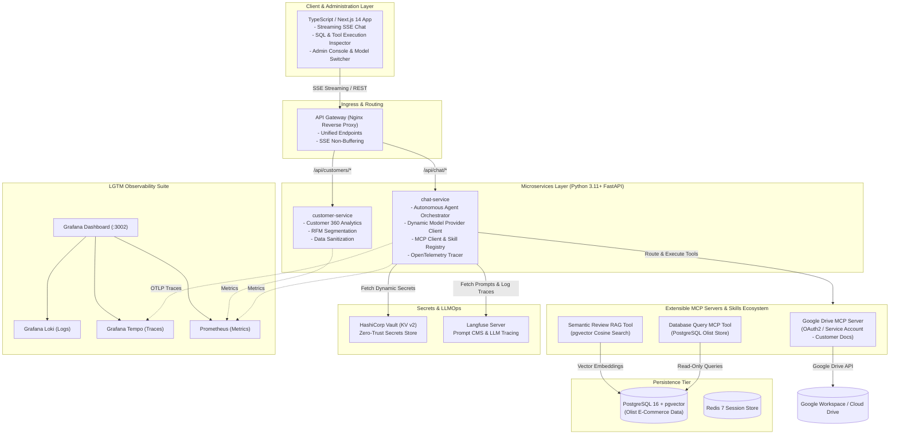

# 🌌 CAPSTONE PROJECT ASSIGNMENT: ENTERPRISE CUSTOMER INTELLIGENCE LLM PLATFORM ("COSMIC EDITION")
## Course Code: CS-702 / SE-801 | Advanced AI Systems Engineering & Cloud-Native Microservices

> **INSTRUCTOR NOTE FOR STUDENTS**:  
> This project is designed as an end-to-end Enterprise Capstone Assignment. The repository provides the complete **Architectural Framework, Abstract Skeletons, Interfaces, Protocol Contracts, and Infrastructure Scaffolding (Docker Compose, HashiCorp Vault, Langfuse, LGTM Stack, K8s Manifests)**.  
> Your task is to **implement the core logic inside the abstract classes (`TODO: [STUDENT ASSIGNMENT]`)**, connect the Model Context Protocol (MCP) servers, implement the Custom Skills (including Google Drive & Text-to-SQL), enforce security guardrails, and pass the automated test suites.

---

## 📑 TABLE OF CONTENTS
1. [Executive Summary & Problem Statement](#1-executive-summary--problem-statement)
2. [Target Dataset: Kaggle Olist Brazilian E-Commerce](#2-target-dataset-kaggle-olist-brazilian-e-commerce)
3. [System Architecture & Multi-Service Blueprint](#3-system-architecture--multi-service-blueprint)
4. [Student Assignment Roadmap (Milestones 1 – 6)](#4-student-assignment-roadmap-milestones-1--6)
   - [Milestone 1: Dynamic OpenAI-Compatible LLM Gateway](#milestone-1-dynamic-openai-compatible-llm-gateway)
   - [Milestone 2: Multi-Layer SQL Guardrails & Database Agent](#milestone-2-multi-layer-sql-guardrails--database-agent)
   - [Milestone 3: Model Context Protocol (MCP) & Google Drive Skill](#milestone-3-model-context-protocol-mcp--google-drive-skill)
   - [Milestone 4: HashiCorp Vault Secrets Manager](#milestone-4-hashicorp-vault-secrets-manager)
   - [Milestone 5: Langfuse Prompt CMS & LLMOps Telemetry](#milestone-5-langfuse-prompt-cms--llmops-telemetry)
   - [Milestone 6: LGTM Observability & Kubernetes (K8s) Deployment](#milestone-6-lgtm-observability--kubernetes-k8s-deployment)
5. [Repository Structure & Abstract Codebase](#5-repository-structure--abstract-codebase)
6. [Grading Rubric & Automated Verification](#6-grading-rubric--automated-verification)
7. [Getting Started (Quickstart for Students)](#7-getting-started-quickstart-for-students)

---

## 1. EXECUTIVE SUMMARY & PROBLEM STATEMENT

Enterprise customer operations require interacting with diverse data sources:
1. **Structured Data**: Relational transactional databases (customers, orders, freight, payments, items).
2. **Semi-structured & Semantic Data**: Customer reviews and feedback ratings requiring vector search.
3. **Unstructured Enterprise Documents**: Customer contracts, SLA terms, invoices, and dispute files stored in cloud storage (e.g. **Google Drive**).

### Assignment Objective:
You will build an extensible, microservice-based **AI Customer Intelligence Platform** that integrates:
- **Agentic Multi-Tool Routing**: An autonomous agent that reasons over user intent and invokes specialized tools via the **Model Context Protocol (MCP)** and **Custom Skills Architecture**.
- **External Document Integration**: Connect to **Google Drive via MCP** to read customer contracts and dispute documents in real time.
- **Universal LLM Compatibility**: Seamless runtime switching between arbitrary OpenAI-compatible backends (OpenAI, DeepSeek, Groq, local vLLM).
- **Enterprise Security with HashiCorp Vault**: Absolute zero hardcoding of API keys or credentials; secrets are securely fetched from Vault KV-v2 at startup.
- **Observability**: Real-time tracing and prompt engineering with **Langfuse**, combined with unified metrics and logging via the **LGTM Stack** (Loki, Grafana, Tempo, Prometheus).

---

## 2. TARGET DATASET: KAGGLE OLIST BRAZILIAN E-COMMERCE

The analytical backbone is built on the gold-standard commercial dataset:
👉 **Brazilian E-Commerce Public Dataset by Olist** ([Kaggle Dataset Link](https://www.kaggle.com/datasets/olistbr/brazilian-ecommerce))

### Schema Breakdown:
- `customers`: Customer IDs, zip code prefix, city, state.
- `orders`: Status, purchase timestamps, delivery timestamps, estimated dates.
- `order_items`: Line-item products, sellers, prices, freight costs.
- `order_payments`: Payment methods (credit card, boleto, voucher), installments, values.
- `order_reviews`: 1–5 star ratings, review titles, review messages.
- `products`: Category names, physical dimensions, product weight.

*(Note: The repository includes `datasets/seed_data.py` which automatically generates 5,000+ realistic records with pgvector embeddings if the Kaggle CSVs are not downloaded).*

---

## 3. SYSTEM ARCHITECTURE & MULTI-SERVICE BLUEPRINT



---

## 4. STUDENT ASSIGNMENT ROADMAP (MILESTONES 1 – 6)

### Milestone 1: Dynamic OpenAI-Compatible LLM Gateway
- **Target File**: `services/chat-service/app/llm/client.py`
- **Objective**: Implement a dynamic client factory that instantiates `AsyncOpenAI` pointing to arbitrary endpoints (`base_url`, `api_key`).
- **Student Tasks**:
  1. Complete `get_openai_client(base_url, api_key)` with timeout and retry handlers.
  2. Implement client resolution that supports OpenAI, DeepSeek, Groq, and local vLLM.
  3. Ensure headers and parameters are properly forwarded for streaming mode.

---

### Milestone 2: Multi-Layer SQL Guardrails & Database Agent
- **Target Files**:
  - `services/chat-service/app/skills/sql_skill.py`
  - `services/chat-service/app/llm/agent.py`
- **Objective**: Implement a rock-solid, production-grade Text-to-SQL executor with AST verification.
- **Student Tasks**:
  1. `validate_sql(query: str) -> str`: Use `sqlparse` to verify the query contains **strictly one SELECT statement**.
  2. Implement a rejection blacklist: Reject queries containing `DROP`, `ALTER`, `TRUNCATE`, `INSERT`, `UPDATE`, `DELETE`, `GRANT`, `information_schema`, or `pg_catalog`.
  3. Enforce automatic row limit clamping: If no `LIMIT` is provided, append `LIMIT 100`. If `LIMIT > 100`, clamp to `100`.
  4. Implement `execute_read_only(query: str)`: Execute inside a PostgreSQL transaction with `SET TRANSACTION READ ONLY` and `SET LOCAL statement_timeout = 5000`.

---

### Milestone 3: Model Context Protocol (MCP) & Google Drive Skill
- **Target Files**:
  - `services/chat-service/app/mcp/client.py`
  - `services/chat-service/app/mcp/registry.py`
  - `services/chat-service/app/skills/base.py`
  - `services/chat-service/app/skills/drive_skill.py`
- **Objective**: Build an extensible tool and skill execution framework conforming to the Model Context Protocol (MCP) specification.
- **Student Tasks**:
  1. **Abstract Base Skill**: Inherit from `AbstractSkill` in `base.py` and implement the schema definition and validation methods.
  2. **Google Drive Connector Skill (`drive_skill.py`)**:
     - Implement `search_files(query: str)`: Searches for customer invoices, SLA contracts, or return policy PDFs on Google Drive.
     - Implement `read_file_content(file_id: str)`: Reads and extracts text content from Google Docs/PDFs.
     - Provide a Mock Mode so students without immediate Google Service Account keys can test locally with synthetic customer contract documents.
  3. **MCP Tool Dispatcher (`mcp/client.py`)**:
     - Standardize MCP tool calls (`tools/list`, `tools/call`) over JSON-RPC.
     - Enable the LLM Agent to autonomously decide whether to query SQL (for metrics) or Google Drive (for contracts/policies).

---

### Milestone 4: HashiCorp Vault Secrets Manager
- **Target Files**:
  - `security/vault/vault_client.py`
  - `services/chat-service/app/core/config.py`
- **Objective**: Complete the enterprise secrets lifecycle using HashiCorp Vault KV-v2.
- **Student Tasks**:
  1. Implement `VaultSecretManager.fetch_secrets()` using the `hvac` Python SDK.
  2. Implement automatic retry with exponential backoff if Vault is initializing.
  3. Implement token renewal and secret caching in private memory.
  4. Ensure zero hardcoded keys remain in the application codebase.

---

### Milestone 5: Langfuse Prompt CMS & LLMOps Telemetry
- **Target Files**:
  - `services/chat-service/app/observability/tracer.py`
  - `services/chat-service/app/routers/chat.py`
- **Objective**: Decouple system prompts from Python code and trace 100% of LLM executions.
- **Student Tasks**:
  1. Integrate `langfuse.get_prompt("olist_customer_agent")` to pull prompt templates dynamically from Langfuse Prompt CMS.
  2. Attach input tokens, output tokens, latency (ms), and active `model_name` to every Langfuse trace.
  3. Implement the `/api/v1/chat/feedback` endpoint to log user satisfaction scores (thumbs up/down) into Langfuse.

---

### Milestone 6: LGTM Observability & Kubernetes (K8s) Deployment
- **Target Files**:
  - `observability/prometheus/prometheus.yaml`
  - `observability/loki/loki-config.yaml`
  - `k8s/*.yaml`
- **Objective**: Wire up distributed telemetry and prepare production Kubernetes manifests.
- **Student Tasks**:
  1. Verify metrics scraping: Ensure FastAPI exports Prometheus metrics at `/metrics` (HTTP RPS, Latency histograms).
  2. Verify OpenTelemetry tracing: Propagate trace context to Grafana Tempo.
  3. Validate Kubernetes manifests: Ensure `k8s/` resources deploy cleanly with correct resource requests, limits, and health probes.

---

## 5. REPOSITORY STRUCTURE & ABSTRACT CODEBASE

```bash
datnguyen/
├── README.md                          # Master Capstone Assignment Document (This file)
├── ARCHITECTURE.md                    # In-depth Architecture & Data Flow Design Specs
├── docker-compose.yml                 # Multi-service infrastructure (Vault, Langfuse, LGTM, DB)
├── Makefile                           # Development automation commands
├── datasets/
│   ├── README.md                      # Kaggle dataset guide
│   ├── download_dataset.sh            # Kaggle CLI download script
│   └── seed_data.py                   # Automated Database Seeder & pgvector embedding generator
├── security/
│   └── vault/
│       ├── config/vault.hcl           # Vault server configuration
│       ├── scripts/init-vault.sh      # Automated unseal & secret provisioning script
│       └── vault_client.py            # [SKELETON] Python Vault Client implementation
├── services/
│   ├── api-gateway/
│   │   └── nginx.conf                 # Gateway reverse proxy
│   ├── chat-service/                  # Core Agent, MCP & Skills Microservice
│   │   ├── app/
│   │   │   ├── main.py                # FastAPI entrypoint
│   │   │   ├── core/config.py         # Dynamic configuration loaded from Vault
│   │   │   ├── llm/
│   │   │   │   ├── client.py          # [SKELETON] OpenAI-compatible client factory
│   │   │   │   └── agent.py           # [SKELETON] Autonomous Agent & Tool Dispatcher
│   │   │   ├── skills/
│   │   │   │   ├── base.py            # [ABSTRACT] AbstractSkill base class & protocol
│   │   │   │   ├── sql_skill.py       # [SKELETON] Text-to-SQL Skill with Guardrails
│   │   │   │   └── drive_skill.py     # [SKELETON] Google Drive MCP Skill (Contracts & SLAs)
│   │   │   ├── mcp/
│   │   │   │   ├── protocol.py        # [ABSTRACT] Model Context Protocol schemas
│   │   │   │   ├── client.py          # [SKELETON] MCP Client protocol handler
│   │   │   │   └── registry.py        # [SKELETON] MCP Server Registry
│   │   │   ├── observability/
│   │   │   │   └── tracer.py          # Langfuse & OpenTelemetry setup
│   │   │   └── routers/
│   │   │       └── chat.py            # SSE Streaming & Feedback router
│   │   ├── Dockerfile
│   │   └── requirements.txt
│   └── customer-service/              # Domain Customer 360 Microservice
│       ├── app/
│       │   ├── main.py                # FastAPI entrypoint
│       │   ├── core/config.py         # Config loaded from Vault
│       │   ├── models.py              # SQLAlchemy ORM models
│       │   └── routers/customers.py   # Customer 360 & RFM endpoints
│       ├── Dockerfile
│       └── requirements.txt
├── frontend/                          # TypeScript Next.js 14 App
│   ├── package.json
│   ├── tsconfig.json
│   ├── src/
│   │   ├── app/
│   │   │   ├── page.tsx               # Chatbot UI with Tool Execution Visualizer
│   │   │   └── admin/page.tsx         # Admin Console: Prompt CMS & Model Switcher
│   │   ├── components/
│   │   │   ├── chat-window.tsx
│   │   │   ├── tool-inspector.tsx     # Visual drawer for SQL & Drive tool calls
│   │   │   └── model-selector.tsx
│   │   └── lib/api.ts
│   └── Dockerfile
├── observability/                     # Complete LGTM Configuration Suite
│   ├── loki/loki-config.yaml
│   ├── promtail/promtail-config.yaml
│   ├── tempo/tempo.yaml
│   ├── prometheus/prometheus.yaml
│   └── grafana/provisioning/
│       ├── datasources/datasources.yaml
│       └── dashboards/dashboards.yaml
├── k8s/                               # Complete Kubernetes Production Manifests
│   ├── namespace.yaml
│   ├── vault-secrets.yaml
│   ├── postgres-deployment.yaml
│   ├── langfuse-deployment.yaml
│   ├── chat-service.yaml
│   ├── customer-service.yaml
│   ├── frontend.yaml
│   └── ingress.yaml
└── tests/                             # Automated Test Suites for Student Grading
    ├── test_sql_guardrails.py         # Unit tests for SQL AST validation
    ├── test_vault_client.py           # Unit tests for Vault secrets retrieval
    └── test_mcp_skills.py             # Unit tests for MCP tools & Drive skill
```

---

## 6. GRADING RUBRIC & AUTOMATED VERIFICATION

| Component | Weight | Student Deliverable & Evaluation Criteria |
| :--- | :---: | :--- |
| **Milestone 1: LLM Gateway** | **15%** | Successfully supports arbitrary `base_url` and `model_name`. Handles streaming tokens without dropping connections. |
| **Milestone 2: SQL Guardrails** | **20%** | All destructive queries (`DROP`, `DELETE`, `UPDATE`) are blocked by AST parsing. Mandatory `LIMIT 100` is enforced. Read-only transactions configured. Passes `test_sql_guardrails.py`. |
| **Milestone 3: MCP & Drive Skill** | **25%** | `AbstractSkill` properly implemented. Google Drive Skill retrieves relevant mock/real customer documents. MCP protocol contracts adhered to. Passes `test_mcp_skills.py`. |
| **Milestone 4: Vault Integration** | **15%** | Microservices dynamically pull API keys and DB credentials from Vault KV-v2 at startup. Zero hardcoded secrets in source code. Passes `test_vault_client.py`. |
| **Milestone 5: Langfuse Prompt CMS**| **15%** | Prompt templates pulled from Langfuse. Traces, token counts, and latency recorded. User feedback submitted successfully. |
| **Milestone 6: LGTM & Kubernetes** | **10%** | Logs searchable in Loki, metrics visible in Prometheus, traces linked in Tempo. K8s manifests syntax-checked with `kubectl --dry-run=client`. |

---

## 7. GETTING STARTED (QUICKSTART FOR STUDENTS)

### Step 1: Initialize Development Environment
```bash
# Clone the student workspace repository
cd datnguyen

# Copy sample environment configuration
cp .env.example .env
```

### Step 2: Boot Infrastructure Services
```bash
# Launch PostgreSQL, Redis, Vault, Langfuse, and the LGTM Stack
docker compose up -d postgres redis vault langfuse-server prometheus loki tempo grafana
```

### Step 3: Seed the Database
```bash
# Populate Olist database (uses Kaggle CSVs or automatic synthetic fallback)
python3 datasets/seed_data.py
```

### Step 4: Run Automated Verification Tests
```bash
# Run pytest to test your implementation progress
pytest tests/ -v
```

### Step 5: Launch Microservices & Frontend
```bash
# Launch all application services
docker compose up -d --build chat-service customer-service frontend api-gateway
```

Access the application at [http://localhost:3000](http://localhost:3000) and the Grafana Observability Dashboard at [http://localhost:3002](http://localhost:3002).
